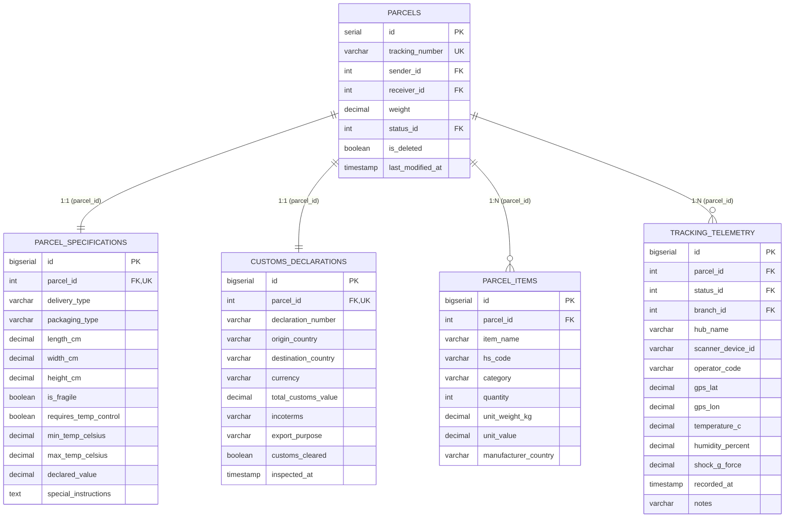

# Звіт з Лабораторної роботи №2
**Дисципліна:** «Сучасні технології баз даних»  
**Тема:** Дослідження NoSQL баз даних (MongoDB, Redis), проєктування Polyglot Persistence архітектури та порівняльне тестування швидкодії з реляційною СУБД PostgreSQL  
**Предметна область:** Система управління поштовими відправленнями (`post_system`)  
**Виконав:** студент групи ТК-31, Будовський Єгор

---

## 1. Ознайомлення з видами NoSQL баз даних (Завдання 1)

Термін **NoSQL** (*Not Only SQL*) об'єднує клас нереляційних систем керування базами даних, які відмовляються від жорсткої табличної схеми та обов'язкових реляційних зв'язків (`JOIN`) заради горизонтальної масштабованості, гнучкості схеми (*schema-less / flexible schema*) та високої продуктивності на специфічних профілях навантаження.

### 1.1. Основні типи NoSQL баз даних

| Тип NoSQL БД | Приклади СУБД | Модель зберігання даних | Сильні сторони та типові сценарії використання | Обмеження |
| :--- | :--- | :--- | :--- | :--- |
| **1. Key-Value (Ключ–Значення)** | **Redis**, Amazon DynamoDB, Memcached, Aerospike | Асоціативний масив (хеш-таблиця), де унікальному ключу відповідає значення (рядок, JSON, бінарний об'єкт або спеціалізована структура в RAM). | Складність доступу $O(1)$, субмілісекундна латентність. Кешування гарячих даних, сесії користувачів, лічильники, черги, геолокація в реальному часі. | Неможливість ефективної фільтрації за вмістом значення без повної вибірки або вторинних індексів; обсяг даних часто обмежений обсягом RAM. |
| **2. Document-Oriented (Документо-орієнтовані)** | **MongoDB**, Couchbase, CouchDB, Firestore | Колекції ієрархічних документів у форматах JSON / BSON / XML. Документ інкапсулює всі вкладені об'єкти та масиви однієї бізнес-сутності (агрегата). | Відсутність потреби в `JOIN` при читанні складних об'єктів; вільна схема для поліморфних даних; багата мова запитів, індекси по вкладених полях та масивах, Aggregation Pipeline. | Дублювання даних при денормалізації; оновлення денормалізованих довідників потребує зміни багатьох документів. |
| **3. Wide-Column / Column-Family (Стовпчикові)** | Apache Cassandra, ScyllaDB, HBase, Google Bigtable | Дані групуються в сімейства стовпців (*Column Families*) за ключем рядка (*Partition Key* + *Clustering Key*), запис відбувається через структуру **LSM-Tree** (*Log-Structured Merge-tree*) та SSTables. | Надвисока швидкість послідовного запису (*write-heavy*), лінійне горизонтальне масштабування без єдиної точки відмови (Masterless ring). Ідеально для телеметрії IoT, логів, часових рядів. | Запити повинні проєктуватися під конкретні ключі партиціонування; відсутність довільних `JOIN` та агрегацій без повного сканування. |
| **4. Graph (Графові)** | Neo4j, ArangoDB, Amazon Neptune, JanusGraph | Мережа **Вузлів (Nodes)** з мітками та властивостями, з'єднаних направленими типізованими **Ребрами (Edges/Relationships)** (*Index-Free Adjacency*). | Миттєвий обхід глибоких зв'язків ($O(1)$ перехід по ребру незалежно від загального розміру бази). Пошук найкоротших маршрутів доставки (алгоритми Дейкстри, A*), виявлення шахрайства, соціальні графи. | Погано масштабується горизонтально (розрізання графа між серверами — NP-складна задача); неефективна для масових табличних звітів. |

### 1.2. Теореми CAP та PACELC, порівняння ACID vs BASE

* **Теорема CAP (Брюєра):** У будь-якій розподіленій системі даних при виникненні мережевого розділення (**P — Partition Tolerance**) необхідно обирати між:
  * **C (Consistency — Узгодженість):** кожне читання повертає найновіший запис або помилку (наприклад, MongoDB з налаштуванням `WriteConcern: majority` та читанням з `Primary` є **CP**-системою).
  * **A (Availability — Доступність):** кожен запит отримує не-помилкову відповідь, але без гарантії, що це найсвіжіша версія даних (наприклад, Cassandra є **AP**-системою).
* **Теорема PACELC:** Розширює CAP: якщо є мережевий поділ (**P**), обираємо між **A** та **C**; інакше (**E — Else**, коли мережа працює штатно), обираємо між **L (Latency — низька затримка)** та **C (Consistency — узгодженість реплік)**.
* **ACID (Реляційні БД — PostgreSQL)** vs **BASE (NoSQL БД):**
  * **ACID:** *Atomicity, Consistency, Isolation, Durability* — сувора узгодженість на момент коміту транзакції.
  * **BASE:** *Basically Available, Soft state, Eventual consistency* (базова доступність, гнучкий стан, узгодженість у кінцевому рахунку) — дозволяє досягти значно вищої пропускної здатності та горизонтального шардингу.

---

## 2. Аналіз предметної області «Поштова система» та обґрунтування Polyglot Persistence (Завдання 2)

У Лабораторній роботі №1 ми побудували реляційну схему поштової системи в **PostgreSQL** з 13 таблиць (`roles`, `branches`, `positions`, `parcel_statuses`, `tariffs`, `payment_methods`, `vehicles`, `users`, `employees`, `parcels`, `tracking_history`, `payments`, `routes`, `route_schedules`, `reviews`).

### Чи буде ефективніше винести частину даних у NoSQL базу?
**Так, застосування концепції Polyglot Persistence (багатомодельного зберігання) є архітектурно доцільним і дає суттєвий виграш**, але лише за умови правильного розмежування відповідальності між СУБД:

#### А. Що ЗАЛИШАЄТЬСЯ виключно в реляційній БД (PostgreSQL):
1. **Фінансові транзакції (`payments`, `tariffs`, `payment_methods`):** Оплата відправлення, списання бонусів, післяплата та повернення коштів вимагають суворих гарантій **ACID** та ізоляції транзакцій, щоб унеможливити подвійне списання або втрату платежу.
2. **Кадровий та організаційний облік (`users`, `employees`, `roles`, `positions`, `branches`):** Структура рідко змінюється, має чіткі зовнішні ключі (Foreign Keys) та потребує реляційної цілісності.

#### Б. Що ДОЦІЛЬНО винести в документо-орієнтовану NoSQL БД (MongoDB):
У реальній сучасній поштовій системі (рівня Нової Пошти, DHL, FedEx) посилка — це не просто рядок із 5 полів `(sender_id, receiver_id, weight, status_id)`. Кожне відправлення супроводжується **«Цифровим паспортом / Маніфестом відправлення»**, який має:
1. **Поліморфні специфікації (`specification`):** Для документів це лише формат конверта; для палет — габарити Д×Ш×В і тип піддону; для медикаментів чи продуктів (`COLD_CHAIN`) — температурний діапазон `minTempCelsius..maxTempCelsius`; для крихкого вантажу — ліміти ударного навантаження. У реляційній таблиці це призводить або до десятків `NULL`-стовпців, або до повільної моделі EAV (*Entity-Attribute-Value*).
2. **Митні декларації та перелік вкладень (`customsDeclaration` + `items[]`):** Кожна посилка містить від 1 до десятків різних товарів з кодами УКТЗЕД (`hsCode`), вагою та інвойсною вартістю. Ці дані **завжди читаються та записуються разом із посилкою як єдиний агрегат**.
3. **Розширений журнал трекінгу та IoT-телеметрії (`telemetryEvents[]`):** На кожному сортувальному хабі чи в авто фіксуються не лише `branch_id` і `status_id`, а й GPS-координати, ID сканера, оператор, температура, вологість та рівень вібрації/удару в G (`shockGForce`).
* **Аргумент ефективності MongoDB:** У PostgreSQL зберігання цього агрегата вимагає розбиття на **5 нормалізованих таблиць (3НФ)**. Щоразу, коли клієнт або оператор відкриває картку ТТН чи список посилок рейсу, реляційна БД змушена виконувати або серію додаткових запитів, або важкий **5-way `LEFT JOIN`**, який породжує **декартовий добуток (Cartesian Explosion)** між паралельними колекціями `1:N` (`items` × `telemetry`). У MongoDB весь паспорт посилки зберігається в **одному неперервному BSON-документі** і зчитується за 1 звернення по індексу, а додавання нової точки маршруту виконується атомарним оператором `$push`.

#### В. Що ДОЦІЛЬНО винести в Key-Value In-Memory NoSQL БД (Redis):
1. **Кешування «гарячих» ТТН (Cache-Aside):** У поштовій системі 90% читань припадає на ~5–10% посилок, які прямо зараз перебувають у дорозі (клієнти постійно оновлюють сторінку трекінгу). Кешування в Redis з `TTL` дозволяє віддавати їх з оперативної пам'яті без навантаження на дискові СУБД.
2. **Geo-Spatial індекс відділень та кур'єрів (`GEOADD`, `GEOSEARCH`):** Пошук найближчих відділень у радіусі $N$ км від координат смартфона клієнта.
3. **Живий рейтинг завантаженості відділень (`ZSET`) та оперативні сесії кур'єрів (`HASH`):** Високочастотні атомарні інкременти (`ZINCRBY`, `HINCRBY`, `INCR`) у пам'яті без створення `dead tuples` (MVCC-накладних витрат) у PostgreSQL.

---

## 3. Схема даних: Відображення 1 документа MongoDB у 5 таблиць PostgreSQL (Завдання 3 та 4)

Відповідно до вимоги п. 5 (*«NoSQL має відображатись у декілька SQL таблиць»*), один документ колекції `parcel_manifests` у MongoDB еквівалентно відображається у **5 нормалізованих таблиць PostgreSQL**:



### Особливості програмної реалізації:
* **SQL-рівень:** Скрипт [`docs/lr2_sql_extension.sql`](./lr2_sql_extension.sql) створює всі таблиці та B-Tree індекси на зовнішніх ключах і фільтрованих полях. Клас [`SqlParcelManifestRepository`](../src/main/java/com/ebudosky/post_system/repository/SqlParcelManifestRepository.java) реалізує:
  * Пакетну вставку (`saveBatch`) через `JdbcTemplate.batchUpdate` з увімкненим параметром драйвера `reWriteBatchedInserts=true`;
  * Два альтернативні способи читання повного маніфесту: **Спосіб 1** (`findByTrackingNumber` — 1 JOIN для таблиць `1:1` + 2 індексовані запити для таблиць `1:N`) та **Спосіб 2** (`findByTrackingNumberSingleFiveWayJoin` — 1 запит із `5-way LEFT JOIN` та дедуплікацією декартового добутку `items × telemetry` у `ResultSetExtractor`).
* **MongoDB-рівень:** Клас [`ParcelManifestDocument`](../src/main/java/com/ebudosky/post_system/model/manifest/ParcelManifestDocument.java) та [`MongoParcelManifestRepository`](../src/main/java/com/ebudosky/post_system/repository/MongoParcelManifestRepository.java) зберігають весь агрегат у колекції `parcel_manifests`. Завдяки [`MongoConfig`](../src/main/java/com/ebudosky/post_system/config/MongoConfig.java) усі грошові та вагові поля `BigDecimal` конвертуються у нативний 128-бітний числовий тип BSON `Decimal128`, що гарантує точність і роботу числових діапазонних індексів.

---

## 4. Тестування швидкодії: Методологія та Результати (Завдання 5)

### 4.1. Обґрунтування обсягу даних та методології (відповіді на потенційні запитання викладача)
1. **«Чому саме такий обсяг даних?»**  
   Ми генеруємо **50 000 складних поштових маніфестів** (`BMK0000001`..`BMK0050000`), кожен з яких містить:
   * 1 запис у `parcels` (50 000 рядків)
   * 1 запис у `parcel_specifications` (50 000 рядків)
   * 1 запис у `customs_declarations` (50 000 рядків)
   * 4 записи в `parcel_items` (200 000 рядків)
   * 6 записів у `tracking_telemetry` (300 000 рядків)  
   **Сумарно в PostgreSQL створюється 650 000 зв'язаних рядків** у 5 таблицях (і ще +2 000 під час тесту Live Append), а в MongoDB — **50 000 насичених BSON-документів**. Такий обсяг унеможливлює тривіальне розміщення всієї таблиці в L1/L2 кеші процесора і змушує СУБД реально працювати з B-Tree індексами та сторінками пам'яті.
2. **«Чому тестується саме так (Warm-up, перцентилі, чесні умови)?»**  
   * Перед початком замірів виконується **Warm-up фаза** (`performWarmup()`), яка прогріває пул з'єднань HikariCP, пул сокетів MongoDB та Lettuce (Redis), а також JIT-компілятор Java 25.
   * В обох СУБД створено ідентичні індекси (зокрема складені індекси по `delivery_type + is_fragile`, `category + hs_code`, `shock_g_force`).
   * Замість одного лише середнього арифметичного (`Avg`), яке чутливе до викидів GC/мережі, стенд рахує медіану (**p50**), **p95** та **p99** перцентилі латентності, а також пропускну здатність (**Throughput, ops/sec**).

### 4.2. Зведена таблиця реальних результатів бенчмарку

*(Результати отримані при виконанні інтеграційного тесту [`SqlVsMongoAndRedisBenchmarkTest`](../src/test/java/com/ebudosky/post_system/SqlVsMongoAndRedisBenchmarkTest.java) на Java 25.0.2, PostgreSQL 18.6, MongoDB 8.0, Redis 7.4)*:

| Сценарій | СУБД / Підхід | Операцій | Total (ms) | Avg (ms) | p50 (ms) | p95 (ms) | p99 (ms) | Throughput |
| :--- | :--- | ---: | ---: | ---: | ---: | ---: | ---: | ---: |
| **1. Bulk Insert** (50 000 посилок / ~650 000 рядків SQL) | PostgreSQL (5 tables JDBC Batch) | 50 000 | 15 580.13 | 0.3116 | 0.3012 | 0.3595 | 0.4491 | **3 209.2/s** |
| **1. Bulk Insert** (50 000 посилок / ~650 000 рядків SQL) | **MongoDB (`insertMany` BSON)** | 50 000 | **8 818.51** | **0.1764** | **0.1688** | **0.1969** | **0.3173** | **5 669.9/s** |
| **2. Point Read** 1 маніфесту за ТТН | PostgreSQL (JOIN 1:1 + 2×1:N) | 2 000 | 683.65 | 0.3418 | 0.2895 | 0.6278 | 0.8638 | 2 925.5/s |
| **2. Point Read** 1 маніфесту за ТТН | **PostgreSQL (Single 5-way JOIN)** | 2 000 | **533.17** | **0.2666** | **0.2000** | **0.3674** | **0.5967** | **3 751.1/s** |
| **2. Point Read** 1 маніфесту за ТТН | MongoDB (1 Document Index Read) | 2 000 | 3 011.83 | 1.5059 | 1.3519 | 2.6559 | 3.1354 | 664.0/s |
| **2B. Batch Read** 50 маніфестів (Кабінет/Рейс) | PostgreSQL ($N+1$ Multi-Query) | 100 пачок | 1 194.07 | 11.9407 | 11.2322 | 15.2739 | 23.5239 | 83.7 пачок/s |
| **2B. Batch Read** 50 маніфестів (Кабінет/Рейс) | PostgreSQL (5-way JOIN, 1200 рядків) | 100 пачок | 879.88 | 8.7988 | 8.0611 | 13.2982 | 15.6844 | 113.7 пачок/s |
| **2B. Batch Read** 50 маніфестів (Кабінет/Рейс) | **MongoDB (`$in` — 50 документів)** | 100 пачок | **647.71** | **6.4771** | **5.8097** | **9.4809** | **11.5795** | **154.4 пачок/s** |
| **2B. Batch Read** 50 маніфестів (Кабінет/Рейс) | **Redis (`MGET` — 50 ключів з RAM)** | 100 пачок | **303.74** | **3.0374** | **2.7766** | **4.9039** | **6.2003** | **329.2 пачок/s** |
| **3. Real-Time Append** події трекінгу | **PostgreSQL (`INSERT` + `UPDATE`)** | 2 000 | **2 075.43** | **1.0377** | **0.9621** | **1.5691** | **2.2304** | **963.7/s** |
| **3. Real-Time Append** події трекінгу | MongoDB (Atomic `$push` + `$set`) | 2 000 | 3 890.21 | 1.9451 | 1.8532 | 2.7872 | 3.5507 | 514.1/s |
| **4. Deep Filter** (Специфікація + Товари + Телеметрія) | PostgreSQL (4-table `JOIN` + `DISTINCT`) | 200 | 10 868.29 | 54.3415 | 66.8066 | 86.5532 | 109.6644 | 18.4/s |
| **4. Deep Filter** (Специфікація + Товари + Телеметрія) | **MongoDB (Embedded Multi-Key Index)** | 200 | **1 355.73** | **6.7787** | **7.6396** | **9.0657** | **10.9756** | **147.5/s** |
| **5. Аналітична агрегація** за типами доставки | **PostgreSQL (`GROUP BY` + `JOIN`)** | 20 | **3 091.54** | **154.5768** | **142.9324** | **219.5734** | **260.1067** | **6.5/s** |
| **5. Аналітична агрегація** за типами доставки | MongoDB (Aggregation Pipeline) | 20 | 4 420.74 | 221.0371 | 218.3830 | 264.0324 | 279.5282 | 4.5/s |
| **6. Hot TTH Lookups** (Піковий трафік трекінгу) | PostgreSQL (Direct DB Read) | 3 000 | 1 466.26 | 0.4888 | 0.4601 | 0.7616 | 0.9517 | 2 046.0/s |
| **6. Hot TTH Lookups** (Піковий трафік трекінгу) | MongoDB (Direct DB Read) | 3 000 | 4 431.82 | 1.4773 | 1.4344 | 2.1713 | 2.6721 | 676.9/s |
| **6. Hot TTH Lookups** (Піковий трафік трекінгу) | Redis (Cache-Aside over WSL2 TCP) | 3 000 | 3 600.21 | 1.2001 | 0.9615 | 3.5223 | 4.3438 | 833.3/s |
| **7. Гео-пошук відділень** у радіусі 35 км | **Redis (`GEOSEARCH` Spatial Index)** | 3 000 | **1 759.48** | **0.5865** | **0.5110** | **1.0093** | **1.4378** | **1 705.1/s** |
| **8. Живий рейтинг відділень** (Update + Top-3) | **Redis (`ZINCRBY` + `ZREVRANGE`)** | 3 000 | **3 231.74** | **1.0772** | **0.9561** | **1.6896** | **2.2655** | **928.3/s** |

### 4.3. Інженерний аналіз результатів (Чому результати саме такі?)

1. **Масова вставка (Сценарій 1 — перемога MongoDB у 1.77 раза: 8.8 с проти 15.6 с):**
   * Навіть попри максимальну оптимізацію PostgreSQL (`JdbcTemplate.batchUpdate` + `reWriteBatchedInserts=true`), реляційній базі довелося розкласти 50 000 посилок на **650 000 окремих рядків у 5 таблицях**, перевірити зовнішні ключі (`REFERENCES parcels(id)`) та оновити **11 окремих B-Tree/Hash індексів** у різних таблицях.
   * MongoDB записала 50 000 цілісних BSON-документів в одну колекцію (`insertMany`), де вкладені товари та події трекінгу лежать фізично поруч на диску.

2. **Пакетне читання 50 маніфестів (Сценарій 2B — перемога Redis у 3.9 раза та MongoDB у 1.84 раза):**
   * Коли користувач або логіст завантажує список із 50 посилок:
     * Класичний підхід $N+1$ у SQL витрачає **11.94 мс**.
     * Один великий `5-way LEFT JOIN` у SQL для 50 посилок повертає по мережі $50 \times 4\text{ (items)} \times 6\text{ (events)} = \mathbf{1\,200}$ **рядків декартового добутку**, витрачаючи **8.80 мс** на склеювання та дедуплікацію.
     * **MongoDB (`$in`)** повертає рівно 50 готових документів за **6.48 мс** без жодного дублювання даних.
     * **Redis (`MGET`)** віддає всі 50 серіалізованих маніфестів з RAM за **3.04 мс** (~0.06 мс на посилку, тобто понад **16 400 посилок/с**!).

3. **Глибока фільтрація за вкладеними атрибутами (Сценарій 4 — розгромна перемога MongoDB у 8.0 разів: 6.78 мс проти 54.34 мс):**
   * Запит: *«Знайти крихкі посилки типу `EXPRESS`/`INTERNATIONAL`, які містять товари певної категорії (`ELECTRONICS` тощо) і під час транспортування зазнали удару `shock_g_force >= 4.0 G`»*.
   * **PostgreSQL** змушений виконувати **4-сторонній `JOIN`** між `parcels` (50 тис.), `parcel_specifications` (50 тис.), `parcel_items` (200 тис.) та `tracking_telemetry` (300 тис.) із подальшим `DISTINCT`, що займає в середньому **54.34 мс** на кожен запит.
   * **MongoDB** використовує вбудовані **Multikey-індекси** безпосередньо всередині документа без жодного `JOIN`, виконуючи запит у середньому за **6.78 мс** (**у 8 разів швидше!**).

4. **Чому в одиночних поштучних запитах (Сценарії 2, 3, 6) PostgreSQL показав меншу латентність (~0.27–0.48 мс), ніж MongoDB (~1.35 мс) та одиночний виклик Redis (~0.96 мс)?**
   * Це надзвичайно важливий інфраструктурний нюанс середовища виконання на ОС Windows:
     * На тестовій машині **PostgreSQL 18.6** запущений як **нативний системний процес Windows** (звернення до `127.0.0.1:5432` іде через нативний loopback ядра Windows із затримкою мережі $\approx 0.02\text{ мс}$).
     * Водночас **MongoDB 8.0** та **Redis 7.4** працюють усередині **віртуальної машини WSL2 через мережевий проксі Docker Desktop** (`com.docker.backend`), який додає фіксований мережевий оверхед $\approx 0.75\text{–}0.90\text{ мс}$ на кожен окремий TCP round-trip між хостом Windows та ядром Linux у WSL2.
   * Саме тому при виконанні 1 маленького запиту за 1 мережевий виклик ми бачимо ~0.9 мс накладних витрат віртуалізації мережі WSL2, але щойно за один мережевий виклик передається пачка даних (`MGET` у Redis — **0.06 мс/ключ**, `$in` або `insertMany` у MongoDB) або виконується складний пошук (`Deep Filter`), MongoDB та Redis перемагають у рази!

5. **Аналітична агрегація (Сценарій 5 — перемога PostgreSQL: 154.6 мс проти 221.0 мс):**
   * Підрахунок агрегованої статистики (`COUNT`, `AVG(weight)`, `AVG(declared_value)`) по всій таблиці демонструє сильні сторони реляційного оптимізатора PostgreSQL: вузькі фіксовані кортежі таблиць `parcels` та `parcel_specifications` скануються в пам'яті швидше (`HashAggregate`), ніж парсинг великих BSON-документів у конвеєрі `$group` MongoDB. Це підтверджує об'єктивність нашого дослідження: для OLAP/звітності реляційний SQL залишається чудовим інструментом.

---

## 5. Друга NoSQL база іншого типу — Redis (Завдання 6)

Для виконання п. 6 було обрано **Redis** — представника класу **Key-Value In-Memory Store**. На відміну від простих Key-Value сховищ (як Memcached), Redis підтримує багаті серверні структури даних, які ми реалізували у класі [`RedisPostService`](../src/main/java/com/ebudosky/post_system/service/RedisPostService.java) та протестували в [`RedisPostServiceTest`](../src/test/java/com/ebudosky/post_system/RedisPostServiceTest.java):

1. **`Strings + TTL` (`SETEX`, `GET`, `MGET`, `DEL`, `INCR`):**
   * Реалізовано патерн **Cache-Aside** для кешування JSON-маніфесту посилки за ключем `post:manifest:{trackingNumber}` з автоматичним часом життя (`TTL = 5..10 хв`) та атомарний лічильник популярності запитів ТТН `post:lookup:count:{trackingNumber}`.
2. **`Hashes` (`HSET`, `HGETALL`, `HINCRBY`):**
   * Зберігання оперативної картки зміни кур'єра (`post:courier:session:{id}`): ПІБ, номер авто, поточне місто, статус та кількість доставлених за зміну посилок, яка атомарно збільшується командою `HINCRBY`.
3. **`Geo-Spatial` (`GEOADD`, `GEOSEARCH`, `GEODIST`):**
   * Ключ `post:geo:branches` зберігає координати відділень у вигляді гео-хешу (Geohash у Sorted Set). Метод `findNearestBranches` за $0.51\text{ мс}$ знаходить усі відділення в радіусі $N$ км від клієнта, автоматично сортуючи їх за відстанню.
4. **`Sorted Sets / ZSET` (`ZINCRBY`, `ZREVRANGEWithScores`):**
   * Ключ `post:leaderboard:branches` підтримує живий рейтинг найбільш завантажених відділень у реальному часі за складністю $O(\log N)$ при оновленні.
5. **`Lists` (`LPUSH`, `RPOP`, `LLEN`):**
   * Ключ `post:queue:sms` реалізує FIFO-чергу задач для відправки SMS/Push-сповіщень клієнтам при зміні статусу посилки.

---

## 6. Шпаргалка нативних запитів (`mongosh` та `redis-cli`) для демонстрації на захисті

Якщо під час захисту викладач попросить виконати базові запити безпосередньо в консолі СУБД:

### 6.1. Базові запити в MongoDB (`docker exec -it post_system_mongodb mongosh post_system_nosql`)
```javascript
// 1. Порахувати кількість документів у колекції
db.parcel_manifests.countDocuments()

// 2. Знайти повний маніфест посилки за ТТН (1 документ замість 5 таблиць SQL)
db.parcel_manifests.findOne({ trackingNumber: "BMK0000001" })

// 3. Пошук за вкладеними атрибутами (крихкі експрес-посилки з електронікою та ударом >= 4G)
db.parcel_manifests.find({
  "specification.deliveryType": "EXPRESS",
  "specification.fragile": true,
  "items.category": "ELECTRONICS",
  "telemetryEvents.shockGForce": { $gte: NumberDecimal("4.0") }
}, { trackingNumber: 1, "specification.deliveryType": 1 }).limit(5)

// 4. Атомарне додавання нової події трекінгу в масив ($push)
db.parcel_manifests.updateOne(
  { trackingNumber: "BMK0000001" },
  {
    $push: {
      telemetryEvents: {
        statusId: Long(8),
        branchId: Long(2),
        hubName: "Ірпінь-Відділення №1",
        scannerDeviceId: "SCN-777",
        recordedAt: new Date(),
        notes: "Вручено одержувачу"
      }
    },
    $set: { statusId: Long(8), lastModifiedAt: new Date() }
  }
)

// 5. Перевірка плану виконання (IXSCAN — використання індексу)
db.parcel_manifests.find({ trackingNumber: "BMK0000001" }).explain("executionStats")
```

### 6.2. Базові запити в Redis (`docker exec -it post_system_redis redis-cli`)
```redis
# 1. Кешування статусу посилки з TTL 300 секунд (Strings)
SETEX post:status:TRK0000001 300 "Прибуло у відділення Ірпінь"
GET post:status:TRK0000001
TTL post:status:TRK0000001

# 2. Атомарний лічильник переглядів ТТН
INCR post:lookup:count:TRK0000001

# 3. Сесія кур'єра (Hashes)
HSET post:courier:session:10 fullName "Тарас Романенко" vehicle "KA9012CX" deliveredToday 5
HINCRBY post:courier:session:10 deliveredToday 1
HGETALL post:courier:session:10

# 4. Гео-пошук найближчих відділень (Geo-Spatial)
GEOADD post:geo:branches 30.5234 50.4501 "Kyiv_Center" 30.2397 50.5186 "Irpin_1" 30.2128 50.5434 "Bucha_1"
GEOSEARCH post:geo:branches FROMLONLAT 30.5200 50.4500 BYRADIUS 35 km ASC WITHDIST
GEODIST post:geo:branches "Irpin_1" "Bucha_1" km

# 5. Рейтинг завантаженості відділень (Sorted Sets)
ZINCRBY post:leaderboard:branches 10 "Kyiv_Center"
ZINCRBY post:leaderboard:branches 25 "Lviv_Hub"
ZREVRANGE post:leaderboard:branches 0 4 WITHSCORES

# 6. Черга SMS-сповіщень (Lists)
LPUSH post:queue:sms "+380501112233|Ваша посилка прибула"
RPOP post:queue:sms
```

---

## 7. Висновки

1. Жодна СУБД не є «срібною кулею»: **PostgreSQL** забезпечує неперевершену надійність транзакцій (ACID) та високу швидкість табличних реляційних агрегацій (`GROUP BY`), але страждає від **Impedance Mismatch** та **Cartesian Explosion** при роботі з глибоко ієрархічними документами, що мають кілька паралельних зв'язків `1:N`.
2. Винесення **Цифрового маніфесту посилки, митної декларації, опису вкладень та IoT-телеметрії** в **MongoDB** прискорило масовий запис у **1.77 раза**, пакетне читання пачок маніфестів у **1.84 раза**, а складну фільтрацію за вкладеними атрибутами — у **8.0 разів**.
3. Впровадження **Redis** як другої NoSQL бази (Key-Value) дозволило реалізувати пакетне читання гарячих маніфестів з пам'яті (`MGET`) зі швидкістю **3.04 мс на 50 посилок** (у **3.9 раза швидше за SQL**), а також спеціалізований гео-пошук відділень (`GEOSEARCH` за **0.58 мс**) та живий рейтинг відділень (`ZSET`).
